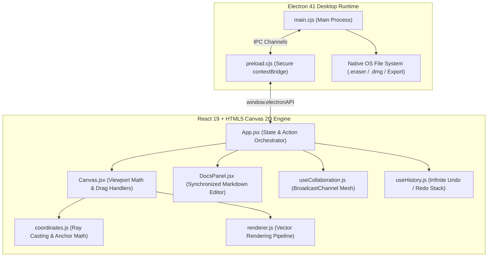

<div align="center">

# ✏️ EraserBoard

### *The High-Performance Visual Architecture & Whiteboard Desktop Studio*

[](https://www.electronjs.org/)
[](https://react.dev/)
[](https://vitejs.dev/)
[](https://tailwindcss.com/)
[](https://github.com/itsriteshx/Diagramming-Whiteboard-Desktop-Application-ElectronJS)
[](LICENSE)

<p align="center">
  <b>A desktop-first technical workspace inspired by Eraser.io that seamlessly bridges interactive vector diagramming with live Markdown system documentation.</b>
</p>

[Key Features](#-key-features) • [Architecture](#-system-architecture) • [Keyboard Shortcuts](#-keyboard-shortcuts) • [Packaging & DMG](#-building-the-desktop-executable) • [Getting Started](#-getting-started)

---

</div>

> [!NOTE]
> **Academic Project Submission (Problem Statement 2501010578):**
> *Diagramming and Collaborative Whiteboard Desktop Application: A desktop-based visual collaboration application inspired by Eraser.io, designed for creating diagrams, system architectures, flowcharts, wireframes, and technical documentation through an interactive canvas.*

---

## 🌟 Executive Summary

**EraserBoard** is built specifically for software engineers, cloud architects, and systems designers. Unlike generic doodling canvases, EraserBoard treats visual diagrams and technical documentation as **first-class citizens of the same workspace**:

- 📐 **Vector-Accurate 2D Canvas Engine**: Pure custom HTML5 Canvas mathematical rendering (sub-pixel coordinate matrix, infinite pan & zoom from 10% to 500%, Ray-Casting hit detection).
- 🧲 **Magnetic Flowchart Connectors**: Dynamic sticky arrows with multi-point anchor snapping that follow shapes as you move or scale them.
- 📝 **Split-View Markdown Docs**: Live technical specifications editor side-by-side with your canvas, supporting code snippets, tables, and callouts.
- 🌐 **Real-Time Collaboration Mesh**: Zero-config peer synchronization with live remote cursors, mesh sync, room codes, and floating emoji reactions.
- 🎨 **Sleek Studio Interface**: Dark mode aesthetics, floating studio dock, Apple-inspired cursive greeting, and an animated welcome splash screen.
- 💾 **Native Desktop Packaging**: Full macOS `.dmg` installer, Electron IPC file system dialogs (`.eraser`, `.json`), and high-res export (SVG, 4x PNG, Markdown).

---

## 🏗️ System Architecture



---

## ✨ Core Feature Highlights

### 1. 📐 Infinite Mathematical Canvas Engine
- **Custom Coordinate Transformation**: Screen-to-World and World-to-Screen matrix math allowing smooth panning and zoom anchoring around the cursor.
- **8-Point Transform Bounding Box**: Multi-handle interactive resizing with live aspect-ratio preservation and custom cursor feedback (`nwse-resize`, `nesw-resize`, etc.).
- **Nested & Overlapping Hit-Detection**: Advanced geometry ray-casting supporting polygons, rotated stars, isometric cylinders, and cloud containers.
- **Radar Minimap**: Live interactive viewport overview radar with click-to-pan camera navigation.

### 2. 🔀 Smart Magnetic Sticky Connectors
- **Proximity Snap Anchors**: Arrows intelligently snap to the top, bottom, left, and right magnetic pins of any shape.
- **Dynamic Angle & Shorten Math**: Vector connector heads automatically recalculate angles and apply offset padding to prevent overlaps.
- **Automatic Trajectory Tracking**: Move any connected block, and all incoming/outgoing arrows adjust seamlessly in real-time.

### 3. 📝 Live Markdown Documentation Studio
- **Dual-Pane Synchronized Workflow**: Write system specifications, API route schemas, or SLA contracts right next to your architecture diagram.
- **Rich Document Elements**: Code syntax blocks, GitHub-style Alerts (`[!NOTE]`, `[!TIP]`, `[!WARNING]`), checklist tasks, tables, and blockquotes.
- **Instant Synchronization**: Loading an architecture template automatically populates both the canvas diagram and the corresponding Markdown docs.

### 4. 🌐 Real-Time Visual Collaboration
- **Zero-Setup Peer Mesh**: Peer sync powered by HTML5 `BroadcastChannel` and room codes with zero external server dependencies.
- **Live Remote Cursors**: High-frequency cursor position broadcasting with custom user names, colored avatar pills, and active tool indicators.
- **Floating Emoji Reactions**: Send interactive live emoji pings (👍, ❤️, 🚀, 🎉, 💡, 🔥) directly onto the canvas.
- **Multi-Window Local Testing**: 1-click command to launch a secondary collaborator window to verify real-time collaboration side-by-side.

### 5. 🖥️ Interactive UI Wireframing & Cloud Suite
- **Native Browser Window Component**: Complete container shell with macOS traffic light controls (*Close, Minimize, Expand*), address capsule, and custom URLs.
- **Interactive Wireframe Elements**: Form inputs, action buttons, image blueprint placeholders, and toggle pill switches.
- **System Architecture Primitives**: 3D Database Cylinders, Cloud VPC Boundaries, Server Cubes, Gateway Ingress Cones, and Cartesian Coordinate Axes.

### 6. 📤 Multi-Format High-Res Export Engine
- **Scalable Vector Graphics (SVG)**: Pure mathematically scalable SVG output preserving vector curves, fonts, and inline styles.
- **High-Density Raster (PNG)**: 1x, 2x (Retina), 3x, and 4x (Ultra HD) resolution rasterization with optional transparent backgrounds.
- **Native Project Files (`.eraser` / `.json`)**: Save diagrams and reopen them anytime with full state persistence.
- **1-Click Clipboard Image Copy**: Copy diagrams directly as images to paste into Slack, Notion, or GitHub issues.

---

## 🎨 Visual Design & Experience

| Module | Design Highlight |
|---|---|
| **Welcome Experience** | Animated splash screen with auto-dismiss progress bar and quick feature highlights |
| **Canvas Greeting** | Iconic MacBook-inspired cursive calligraphy `"hello"` header on startup |
| **Studio Color Palette** | Curated developer palettes: *Modern Dark, Cyber Indigo, Pastel Cloud, Retro Terminal* |
| **Toolbar Dock** | Floating bottom ergonomic pill dock with categorized drawer popovers |
| **Inspector Panel** | Right-docked property inspector with native hex eyedropper, corner radius controls, and layer management |

---

## ⌨️ Keyboard Shortcuts Reference

| Key / Shortcut | Tool / Action | Description |
| :--- | :--- | :--- |
| <kbd>V</kbd> | **Select Tool** | Select, transform, and move shapes |
| <kbd>H</kbd> / <kbd>Space</kbd> + Drag | **Hand Tool** | Infinite canvas panning |
| <kbd>R</kbd> | **Rectangle** | Draw process box or container |
| <kbd>D</kbd> | **Diamond** | Decision tree branch node |
| <kbd>O</kbd> | **Ellipse** | Circular start/end state |
| <kbd>A</kbd> | **Arrow** | Smart magnetic connector arrow |
| <kbd>L</kbd> | **Line** | Straight line divider |
| <kbd>B</kbd> | **Database** | 3D Database cylinder storage |
| <kbd>C</kbd> | **Cloud** | Cloud VPC infrastructure boundary |
| <kbd>P</kbd> | **Pen** | Smooth freehand annotation pen |
| <kbd>T</kbd> | **Text** | Typography label with font options |
| <kbd>E</kbd> | **Eraser** | Delete shapes on click or hover |
| <kbd>⌘</kbd> + <kbd>K</kbd> | **Command Palette** | Spotlight fuzzy search for tools & actions |
| <kbd>⌘</kbd> + <kbd>Z</kbd> / <kbd>⌘</kbd> + <kbd>Y</kbd> | **Undo / Redo** | Infinite snapshot traversal |
| <kbd>⌘</kbd> + <kbd>G</kbd> / <kbd>⇧</kbd><kbd>⌘</kbd> + <kbd>G</kbd> | **Group / Ungroup** | Combine or detach selected shapes |
| <kbd>⌘</kbd> + <kbd>D</kbd> | **Duplicate** | Clone element with smart offset |
| <kbd>Delete</kbd> / <kbd>Backspace</kbd> | **Delete** | Remove selected shapes |
| <kbd>?</kbd> or <kbd>⌘</kbd> + <kbd>/</kbd> | **Help Modal** | Open interactive keyboard cheatsheet |

---

## 📦 Building the Desktop Executable

EraserBoard includes automated packaging scripts for creating native distributables:

### 🍏 Build macOS Installer (`.dmg`)
```bash
# Generate the optimized macOS DMG installer
npm run dist:dmg
```
Output artifact is generated in:
```text
release/EraserBoard.dmg
```

---

## 🚀 Getting Started

### Prerequisites
- [Node.js](https://nodejs.org/) (`v18.x` or higher)
- `npm` or `yarn`

### 1. Clone the Repository
```bash
git clone https://github.com/itsriteshx/Diagramming-Whiteboard-Desktop-Application-ElectronJS.git
cd Diagramming-Whiteboard-Desktop-Application-ElectronJS
```

### 2. Install Dependencies
```bash
npm install
```

### 3. Run Development Server
```bash
npm run dev:all
```
*This starts the Vite HMR server on `http://localhost:5173` and automatically launches the Electron desktop application window.*

### 4. Build Production Bundle
```bash
npm run build
```

---

## 📄 License
This project is open-source and distributed under the **MIT License**.

<div align="center">
  <sub>Built with ❤️ by Ritesh Kumar • Inspired by Eraser.io</sub>
</div>
